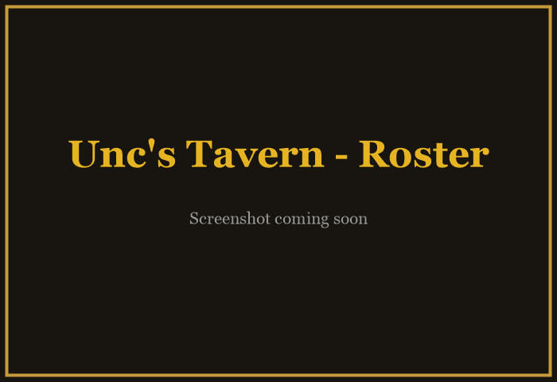
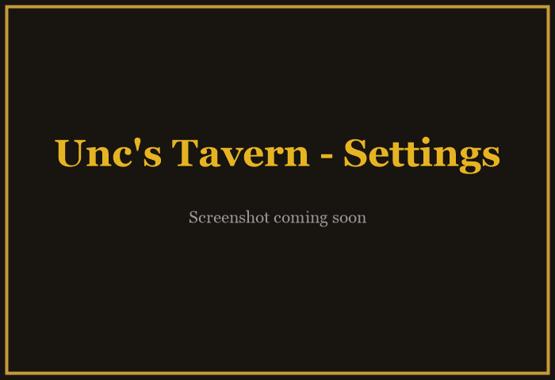

# Unc's Tavern

A guild hub addon for **&lt;Unc of Azeroth&gt;** on World of Warcraft: Forever.

[](https://github.com/StillScrub/Uncs_Tavern/releases/latest)
[-c69b3a)](#installation)
[](LICENSE)

### [⬇ Download latest release](https://github.com/StillScrub/Uncs_Tavern/releases/latest)

---

## Features

The guild is detected automatically, so the addon works for any guild. Everything is event-driven and stays out of combat and protected actions: the addon fills things in, and you press the final button.

**Roster tab**
- Every guild member with class-colored name, level, class, and zone (or how long they've been offline).
- Click a column header to sort, search by name, and toggle "Show offline" (remembered per character).
- Footer shows member, online, and Unc's Tavern user counts.
- **Sync** button to ask everyone running the addon to check in again.

**Wishlist tab**
- Request items: drag an item from your bags into the slot, set quantity, an optional note, and payment (**Gift** or **Pay up to** a price per item).
- List shows item (quality-colored), progress (`8 / 20`), requester (class-colored), payment, note, and claims.
- Filters: **All / Mats / Gear / Mine**, plus **Hide mine**.
- **Claims** ("I'm sending N") so guildmates don't double-send. Claims last 72 hours.
- **Auto-complete:** items you take from the mailbox count toward your requests automatically; the **Got** button fixes counts for trades or gathered items. Finished requests disappear for everyone.
- Requests and claims **sync across the guild**, live and on login; online members pass them along while you're offline.

**Level-up post**
- On level-up, a popup offers to post `[Unc's Tavern] <Name> reached level <N>!` to guild chat with one click. (WoW: Forever only lets addons post to chat when you click.)
- Link your Battle.net account to Discord so your posts reach the guild Discord.

**Minimap button & Settings**
- Minimap button: left-click opens the window, right-click opens Settings, drag to move.
- Settings tab with toggles for level-up posts and the minimap button.

## Screenshots

| Roster | Wishlist | Settings |
|---|---|---|
|  |  |  |

## Installation

1. Download `Uncs_Tavern-vX.Y.Z.zip` from the [latest release](https://github.com/StillScrub/Uncs_Tavern/releases/latest).
2. Extract it into your game folder's `_forever_\Interface\AddOns\`, so you end up with:
   ```
   World of Warcraft\_forever_\Interface\AddOns\Uncs_Tavern\Uncs_Tavern.toc
   ```
3. Restart the game (or log out to character select) and make sure **Unc's Tavern** is enabled in the AddOns list.

To update, delete the old `Uncs_Tavern` folder and extract the new zip the same way. Your saved data is kept.

## Usage

| Command | What it does |
|---|---|
| `/tavern` | Open or close the window |
| `/tavern help` | List all commands |
| `/tavern sync` | Show who in the guild runs the addon |
| `/tavern wishlist` | Show wishlist sync status |
| `/tavern levelup` | Preview your level-up line (sends nothing) |
| `/tavern levelup popup` | Show the level-up popup now |
| `/tavern pvptest` | Diagnostic: print what PvP data the client exposes (`pvptest listen` logs live PvP events) |

You can also open the window from the minimap button.

## Roadmap

Coming soon:
- **PvP stats** on the roster: Kills, Deaths and K/D shared over guild sync.
- **Wishlist item search** and **rule requests** (e.g. Cloth, level 26+, 4+ Intellect).
- **Bag tooltips:** "Wanted by &lt;name&gt;: N more · price" on wanted items.
- **Vendor / auction house / mailbox popup:** "N items in your bags are on the guild wishlist".
- **Mailbox "Guild Requests" tab:** pick a request and get a ready-to-send mail draft (recipient, items, COD).
- **Discord bot:** reads the level-up lines and updates a daily leaderboard.

## Reporting bugs

[Open an issue](https://github.com/StillScrub/Uncs_Tavern/issues/new/choose) using the bug report template. Please include:
- what happened and the steps to reproduce it,
- the full error from [BugSack](https://www.curseforge.com/wow/addons/bugsack) if there is one (or turn on `/console scriptErrors 1`),
- your addon version (shown by `/tavern help`).

## License

[MIT](LICENSE) © StillScrub
