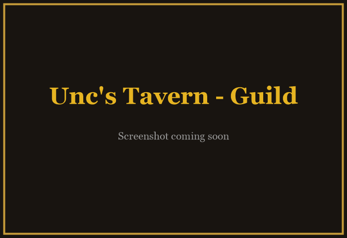
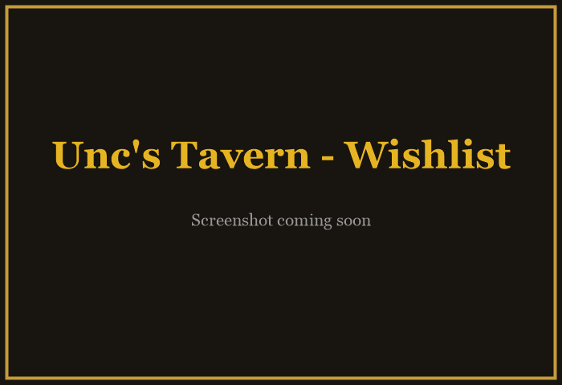
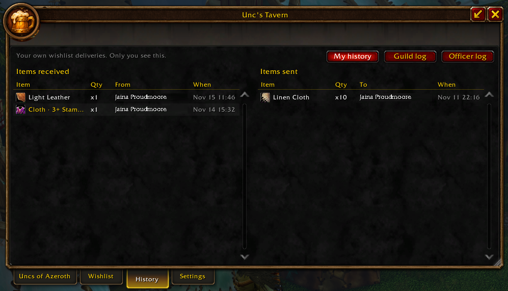
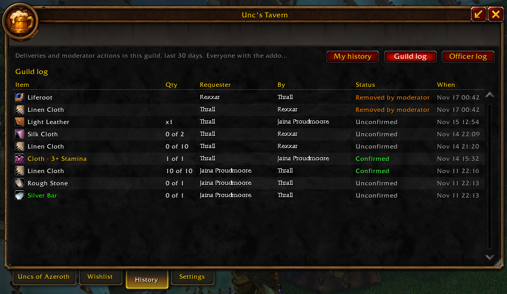
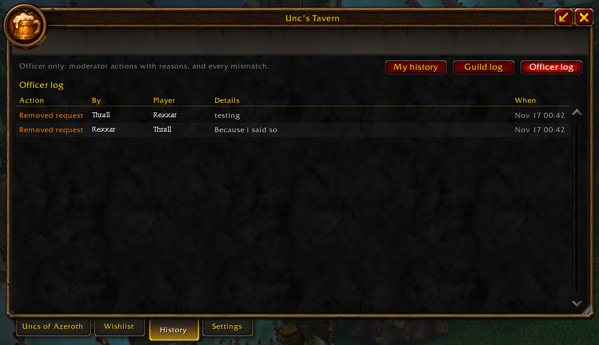
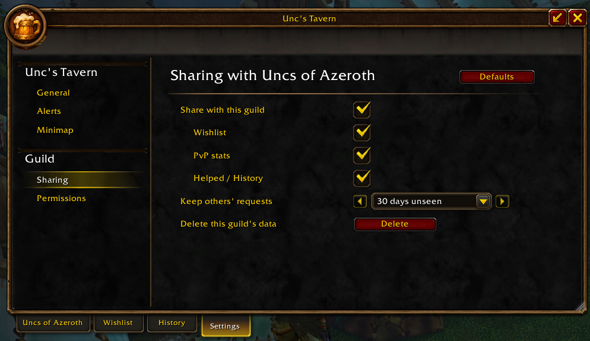

# Unc's Tavern

A guild hub addon for any guild on World of Warcraft: Forever. It adds a toggleable Unc's Tavern view to the Guild & Communities window (J): your guild's roster with PvP stats, a shared wishlist, delivery history and moderation tools. Your guild is detected in game, and everything is shared only with your own guildmates who run the addon.

[](https://github.com/StillScrub/Uncs_Tavern/releases/latest)
[-c69b3a)](#installation)
[](LICENSE)

### [⬇ Download latest release](https://github.com/StillScrub/Uncs_Tavern/releases/latest)

---

## Features

Press **J** to open Blizzard's normal guild window, then click the **Unc's Tavern icon in the top-left corner** (over the portrait) to swap to the Unc's Tavern window in the same spot. Click the icon in its corner to swap back. Guild chat and everything else in Blizzard's window stays exactly as it is.

The guild is detected automatically, so the addon works for any guild. Everything is event-driven and stays out of combat and protected actions: the addon fills things in, and you press the final button.

**Guild window swap**
- The Unc's Tavern icon sits inside the guild window's portrait; it is the only change to Blizzard's UI.
- Clicking it closes the guild window and opens the Unc's Tavern window in the same spot, with bottom tabs **[your guild's name] · Wishlist · History · Settings**. The icon in its corner swaps back.
- Drag the window to move it, resize it from the bottom-right corner, or reset it to the guild window's size with the button next to the X. It opens on the guild tab. No guild: no icon.

**Guild tab (roster)**
- Every guild member with class icon and class-colored name, level, zone (or how long they've been offline), and rank.
- Click a column header to sort, search by name, and toggle "Show offline" (remembered per character).
- Hover a member to see their level, class, rank and public note.
- Footer: "X of Y online · Z using Unc's Tavern".
- **PvP stats** (self-reported) for members running the addon: Kills (lifetime honorable kills), Deaths (deaths to players), K/D, and Dishonorable kills (players too low level to give honor; not part of K/D). Hover a member for killing blows, dishonorable deaths and who has killed them most.
- **Helped:** how many times each member has delivered wishlist items to a guildmate, as confirmed by the person who received them.
- **Sync** button to ask everyone running the addon to check in again.

**Wishlist tab**
- Request items: drag an item from your bags into the slot or **search by name**, set quantity, an optional note, and payment (**Gift** or **Pay up to** a price per item). *Pay up to is greyed out for now: Cash on Delivery mail fails on the WoW: Forever server.*
- **Rule requests:** ask for any gear that fits, e.g. "Cloth, any slot, required level 26+, 4+ Intellect", optionally with a second stat.

- List shows item (quality-colored), progress (`8 / 20`), requester (class-colored), payment, note, and claims.
- Filters: **All / Mats / Gear / Mine**, plus **Hide mine**.
- **Claims** ("I'm sending N") so guildmates don't double-send. Claims last 72 hours.
- **Auto-complete:** items you take from the mailbox count toward your requests automatically; the **Got** button fixes counts for trades or gathered items. Finished requests disappear for everyone.
- Requests and claims **sync across the guild**, live and on login. Only the owner ever sends their own requests and claims (nothing is passed along by others), so you see a request once its owner has been online at the same time as you.

**History tab**
- Your own **Items received** and **Items sent** through the wishlist (only you see it).
- **Guild log:** every delivery in the guild marked **Confirmed** (helper and receiver agree), **Unconfirmed** (only one side) or **Mismatch** (in red), plus moderator actions.
- **Officer log** (ranks the guild leader allows): moderator actions with reasons, and every mismatch.

**Rank permissions** (Settings > Guild > Permissions)
- The guild leader picks which ranks can **moderate** (remove any request, clear any claim, by right-clicking a Wishlist row) and which can **see the officer log**. Default: guild leader only. Every action is logged.

**Alerts**
- Item tooltips show who in the guild wants an item ("Wanted by <name>: N more · price").
- Once per login, a popup at vendors, the auction house or the mailbox lists bag items that fill guildmates' requests (**Ignore forever** turns it off). Selling one warns you and points to the Buyback tab.
- Requests from players who left or were kicked from the guild disappear right away.
- A red warning when a guildmate's mail asks more COD than your wishlist price for those items.
- A badge on the minimap button counts new requests until you open the Wishlist tab.

**Level-up post**
- On level-up, a popup offers to post `[Unc's Tavern] <Name> reached level <N>!` to guild chat with one click. (WoW: Forever only lets addons post to chat when you click.)
- If your guild mirrors guild chat to Discord, the post reaches it like any guild message (Blizzard's bridge only carries players whose Battle.net account is linked to Discord). The line format never changes, so a guild's own Discord bot can read it.

**Minimap button & Settings**
- Minimap button: left-click opens or closes Unc's Tavern (swapping with the guild window if it's open), right-click opens its Settings; drag to move.
- Settings tab in the style of the game's Options window: categories on the left (General, Alerts, Minimap, Sharing), their settings on the right, a Defaults button per page; hover a setting for its description.

## Screenshots

| Guild tab: roster with PvP stats and Helped | Wishlist: item and rule requests |
|---|---|
|  |  |
| **History: your own deliveries** | **Guild log: deliveries and moderator actions** |
|  |  |
| **Officer log: moderator reasons (allowed ranks only)** | **Settings: what you share with your guild** |
|  |  |
| **Settings: general** | |
|  | |

## Installation

1. Download `Uncs_Tavern-vX.Y.Z.zip` from the [latest release](https://github.com/StillScrub/Uncs_Tavern/releases/latest).
2. Extract it into your game folder's `_forever_\Interface\AddOns\`, so you end up with:
   ```
   World of Warcraft\_forever_\Interface\AddOns\Uncs_Tavern\Uncs_Tavern.toc
   ```
3. Restart the game (or log out to character select) and make sure **Unc's Tavern** is enabled in the AddOns list.

To update, delete the old `Uncs_Tavern` folder and extract the new zip the same way. Your saved data is kept.

## Usage

1. Press **J** to open the Guild & Communities window.
2. Click the **Unc's Tavern icon** in the top-left corner to swap to the Unc's Tavern window; click the icon in its corner to swap back.

| Command | What it does |
|---|---|
| `/tavern` | Open or close Unc's Tavern (swaps with the guild window if it's open) |
| `/tavern help` | List all commands |
| `/tavern sync` | Show who in the guild runs the addon |
| `/tavern wishlist` | Show wishlist sync status |
| `/tavern levelup` | Preview your level-up line (sends nothing) |
| `/tavern levelup popup` | Show the level-up popup now |
| `/tavern pvpdebug` | Print your PvP numbers, where they come from, and the last kill/death signal |
| `/tavern debug on` / `off` | Developer options |
| `/tavern securitytest` | Developer check: feeds forged messages to the addon in a sandbox and prints which were rejected (sends nothing; needs debug on) |

The minimap button works like `/tavern` (right-click opens the Settings tab).

## Roadmap

Coming soon:
- **Mailbox "Guild Requests" panel:** pick a request and get a ready-to-send mail draft (recipient, items, COD). You press Send.

Later:
- **Ledger keepers (opt-in, off by default):** the guild leader can let trusted ranks pass on other players' requests and claims, so you see a request even if you're never online at the same time as its owner. Owners and receivers each have to switch it on themselves, behind a "use at your own risk" warning; passed-on rows are labelled "via <Keeper>" until the owner confirms them.

## Privacy & Safety

- **Opt-in:** the first time you log in with a guild, the addon asks whether to share with that guild. Until you click Enable it sends nothing and accepts nothing. You can switch sharing, or each part of it, off any time in Settings.
- **What is shared** (only with members of your current guild who run the addon): your wishlist requests and claims and what you've received; your PvP numbers; who delivered items to you.
- **Never shared:** your bags, gold, mail, other guilds' data, or which characters belong to you.
- **Stays in the guild:** data is stored per guild. Leaving or changing guild stops syncing and hides the old data; **Delete this guild's data** in Settings removes it.
- **Can't be faked by a modified copy:** only you can create, change or remove your requests and claims; PvP numbers are accepted only about the sender (and labelled self-reported); Helped counts only when the receiver's own addon confirms it. Received text is stripped of links, colors and textures, and item names are always built by your own game client.
- **Your money and items:** the addon never sends or takes mail, pays COD, trades or sells anything. It can fill things in; you always press the game's own button. It warns you when a guildmate's COD is above your wishlist price.

Found a security problem? Please report it privately; see [SECURITY.md](SECURITY.md).

## Reporting bugs

[Open an issue](https://github.com/StillScrub/Uncs_Tavern/issues/new/choose) using the bug report template. Please include:
- what happened and the steps to reproduce it,
- the full error from [BugSack](https://www.curseforge.com/wow/addons/bugsack) if there is one (or turn on `/console scriptErrors 1`),
- your addon version (shown by `/tavern help`).

## License

[MIT](LICENSE) © StillScrub
